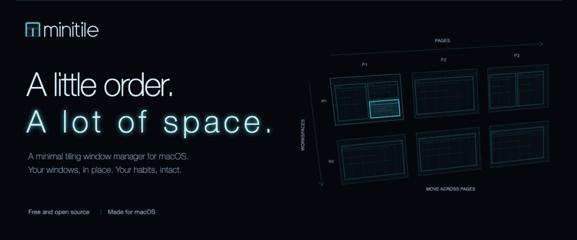

<picture>
  <source media="(prefers-reduced-motion: reduce)" srcset="web/assets/welcome.png">
  
</picture>

<p align="center">Free and open source under Apache-2.0. Native Swift. Familiar macOS shortcuts.</p>

<p align="center"><a href="https://github.com/fiorix/minitile/releases/latest/download/minitile.dmg"></a></p>

<p align="center"><a href="#design">Design</a> &nbsp; / &nbsp; <a href="#getting-started">Getting started</a> &nbsp; / &nbsp; <a href="#shortcuts">Shortcuts</a> &nbsp; / &nbsp; <a href="#contributing">Contributing</a></p>

## minitile

minitile is a small tiling window manager for macOS. It arranges your windows, gives them room, and stays in the menu bar. Pages run horizontally, workspaces stack vertically, and the shortcuts build on the ones your Mac already uses.

**In development.** The core, command-line tool, and macOS shell are implemented. Live verification has covered one display; multiple displays and several newer interactions still need on-screen testing. See [DESIGN.md](DESIGN.md) for the current implementation and verification status. The illustrations here and on the website are conceptual previews, not recordings of the native app.

## Design

- **A small, predictable model.** Each page has up to four tiled windows. Additional pages make room for more work, and workspaces group those pages. Floating windows are supported outside the tile limit.
- **Blend with macOS.** A native Swift/AppKit app, a menu bar presence, and ordinary app windows. Resize an edge, drag to swap tiles, or use the layout picker while dragging.
- **Reuse familiar chords.** Control and arrows navigate. Add Shift to move a window. Cmd+Tab switches windows, Cmd+backtick cycles the current page, and Cmd+H shows every shortcut. Cmd+W and Cmd+Q remain native.
- **Keep the system intact.** System Integrity Protection stays enabled. minitile uses Accessibility and SkyLight; page transitions additionally use Screen Recording permission.
- **Keep it scriptable.** The `mntl` command-line tool exposes the window manager's commands. Configuration is a small TOML file.

```text
                     pages
                <------------- >
workspace 1     [ A | B ] [ C ]
workspace 2     [ D | E ] [ F | G ]
                    |          |
                 workspaces run vertically
```

The [full design](DESIGN.md) describes placement, layouts, window lifecycles, macOS integration, and the command protocol.

## Download

[Download minitile for macOS](https://github.com/fiorix/minitile/releases/latest/download/minitile.dmg), for Apple silicon Macs with macOS 26 or later. Open the disk image and drag Minitile to Applications. Releases are signed with a Developer ID and notarized by Apple; release notes and SHA-256 checksums are on the [releases page](https://github.com/fiorix/minitile/releases). The project's live testing so far has been on macOS 27.

Or install with [Homebrew](https://brew.sh), which also links `mntl` onto your PATH. Homebrew loads packages from taps outside its own catalogue only once you trust them:

```sh
brew tap fiorix/tap
brew trust --cask fiorix/tap/minitile
brew install --cask fiorix/tap/minitile
```

With the disk image, the `mntl` command line tool ships inside the app. To run it from a terminal, link it onto your PATH:

```sh
sudo mkdir -p /usr/local/bin
sudo ln -sf /Applications/Minitile.app/Contents/MacOS/mntl /usr/local/bin/mntl
```

For development, build from a checkout with a compatible Swift toolchain (the package requires Swift tools 6.2 or later):

```sh
./scripts/build-app.sh
open build/Minitile.app
```

The script creates `build/Minitile.app`, with the `mntl` command line tool inside it, and a copy at `build/mntl`. It signs the app using an installed Apple Development identity by default. Set `MINITILE_SIGN_IDENTITY` to another installed signing identity if needed. For an ad-hoc development build, use `MINITILE_SIGN_IDENTITY=- ./scripts/build-app.sh`; the Accessibility grant may need renewing after rebuilds. Local builds are named Minitile Dev and have their own bundle ID, so System Settings lists them apart from an installed release, with their own Accessibility and Screen Recording permissions. Both share the configuration, state and socket, so run only one at a time.

## Getting started

1. **Required: a second desktop on every display.** minitile keeps the pages you are not looking at on a second desktop, one per display, and macOS does not let apps create desktops. Open Mission Control and click + at the top of each display so it has two. Without a second desktop, minitile cannot tile that display, and its menu bar item names the display and shows how to add one.
2. **Required: Accessibility.** minitile uses it to move, resize and focus windows, and to hear its keyboard shortcuts and trackpad swipes. Grant it when minitile first starts, in System Settings > Privacy & Security > Accessibility. Without it, minitile cannot do anything.
3. **Optional: Screen & System Audio Recording.** This is only for the slide between pages and the bounce at the edges: minitile captures the screen for the moment of the animation, and nothing is saved or sent anywhere. It never records audio, even though macOS names the setting for both. Without it, or with `transition_ms = 0`, pages change at once. After turning it on, quit and reopen minitile. In System Settings > Desktop & Dock, keep **Displays have separate Spaces** on, which minitile needs, and turn off **Automatically rearrange Spaces based on most recent use**. If native tiling interferes with dragging, turn off the drag-to-tile options as well.
4. Open a few windows. Use Control and the arrow keys to move around, and add Shift to take the focused window with you. Press Cmd+H to see every shortcut, and Esc to close it.

minitile takes over the system shortcuts listed below while active, including Mission Control's Control+Up/Down, Control+Option+Space for switching input sources, the native app switcher's Cmd+Tab, and Cmd+H, which hides apps in macOS. Apps can still be hidden from their app menu or the Dock. Mission Control remains available through its dedicated key or Dock. Quit minitile to return those keys to macOS. Windows on its stash desktop remain reachable through Mission Control after quitting.

## Shortcuts

| Shortcut | Action |
| --- | --- |
| Control + arrows | Move around |
| Control + Shift + arrows | Move the focused window |
| Control + Option + arrows | Resize the focused window |
| Control + Option + Space | Cycle the page's layouts |
| Cmd + Tab / Cmd + Shift + Tab | Switch windows: a ring across the grid from the top-left; hold Cmd to see the switcher, with apps that have no window in a row under the grid, and press Q to quit the chosen app |
| Cmd + backtick / Cmd + Shift + backtick | Cycle windows on the current page |
| Cmd + Option + backtick / Cmd + Option + Shift + backtick | Swap the focused window with the next / previous slot on its page |
| Cmd + H | Show every shortcut while Cmd is held |
| Cmd + Option + H | Nothing: Hide Others is blocked |

No special modifier or Caps Lock remap. While a move or resize chord is held, minitile outlines the window it acts on. Bindings can be changed or unbound in `~/.config/minitile/minitile.toml`. Control+Option overlaps with VoiceOver's default modifier, so remap those bindings if you use VoiceOver.

```toml
gaps = 8
padding = 8
transition_ms = 500

[bindings]
# Leave Cmd+Tab with the native macOS app switcher.
"cmd+tab" = ""
"cmd+shift+tab" = ""
# Keep Cmd+H hiding apps.
"cmd+h" = ""
```

Configuration reloads automatically when the file changes. `mntl config open` opens it and `mntl config reload` reloads it by hand.

## Mouse and trackpad

- Drag a tiled window's inner edge to resize its shared divider. Drag a corner to adjust both dividers.
- Choose a fill, half or quarter from macOS's green-button tiling menu to keep that shape with minitile's usual spacing. Other windows rearrange around it; any that no longer fit move to their own minitile workspaces.
- Drop a window onto another tile on the same page to swap their positions.
- While dragging, use the layout picker in the middle of the display: hover a tile to preview placement, then drop onto it to select that layout and position.
- Drop at a screen edge to move the window: left/right nudge between pages; top/bottom carry between workspaces, like Control+Shift+arrows. Four targets appear during a window move and the selected edge lights up. The move happens once on release; move away or press Escape to cancel the edge action. Set `edge_drops = false` to leave screen edges with macOS.
- Press Control+arrows while dragging to nudge the window between pages or carry it between workspaces. Release the mouse to finish the move.
- Use the configured three- or four-finger desktop gesture to navigate: horizontal swipes for pages and vertical swipes for workspaces. Set `trackpad_swipes = false` to leave these gestures with macOS.

## Command line

Run the companion tool while minitile is running:

```sh
./build/mntl page list
./build/mntl page next
./build/mntl page variant
./build/mntl window nudge right
./build/mntl config reload
```

See [the command grammar](DESIGN.md#architecture) for the protocol and [the configuration reference](DESIGN.md#config) for all default bindings and options.

## Contributing

Useful contributions include reproducible macOS integration reports, multiple-display testing, accessibility improvements, and small changes that preserve the model. Include your macOS version, display arrangement, steps to reproduce, and expected behavior when reporting a problem.

Read [DESIGN.md](DESIGN.md) before changing behavior. The main boundaries are:

| Component | Responsibility |
| --- | --- |
| `Sources/MinitileCore` | Window state, placement, layouts, and commands |
| `Sources/MinitileIPC` | Local command protocol and sockets |
| `Sources/minitile` | Native app, observation, permissions, and reconciliation |
| `Sources/CSkyLight` | macOS window and Space integration |
| `Sources/mntl` | Command-line client |
| `web` | Static consumer website and shared brand assets |

Run `swift test` for the Swift tests. Tests use Swift Testing; interactive macOS verification is separate and described in [development and testing](DESIGN.md#development-and-testing).

To preview the website locally:

```sh
cd web
npm run dev
```

Open `http://127.0.0.1:4173`. There are no website runtime dependencies or build step. See [web/README.md](web/README.md) for preview checks and publication setup, and [BRAND.md](BRAND.md) for the visual system and asset generation.

## License

Copyright 2026 Alexandre Fiori. Licensed under the [Apache License, Version 2.0](LICENSE).
